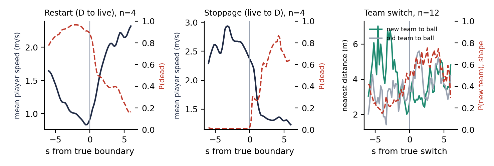
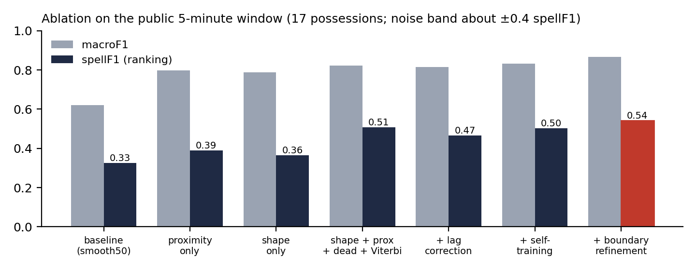
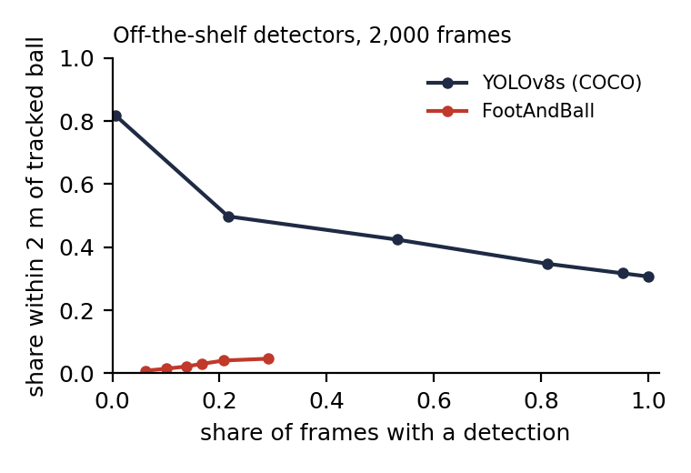

# Who Has the Ball? Frame-Level Possession from Uncorrected Tracking with Self-Supervised Team Shape and Duration-Constrained Decoding

**Sebastian Dulong Salazar, Santiago Fernández del Castillo, Ulises Quevedo**  
Team Cochinae · More than a Hack 2027 (Metrica Sports × FC Barcelona × Mobile World Capital)

---

## Abstract

We label every frame of a professional match (FC Barcelona vs Athletic Club, 199,319 frames) as
*home possession*, *away possession* or *dead ball*. The only inputs are automatic, uncorrected
tracking and its metadata. The ball is missing on 41% of graded frames, and the ranking metric
(spellF1) rewards recovering whole possessions rather than per-frame accuracy.

We combine three signals:

1. A **team-shape classifier**, trained self-supervised on frames where the ball is
   unambiguously at one team's feet, which reads possession from the 22 players alone.
2. **Ball-proximity evidence** where the ball is visible.
3. A **physical dead-ball model**, an 8-feature logistic regression on player and ball motion.

A Viterbi decoder with switching costs and a minimum stoppage length turns these into whole
possessions. One round of self-training follows, then a boundary refinement that places restarts
at the players' slowest moment.

On the public 5-minute window the method reaches **spellF1 0.542 / macroF1 0.867**, against
0.326 / 0.621 for the published baseline. No stage uses hand labels. Settings were chosen by
label-free stability analysis, not by tuning on the 17 public possessions, and the output is
reproducible byte for byte. We also report what did not work: tactical tagging as a team prior,
a last-controller rule, broadcast tracking as a ball source, and two off-the-shelf video ball
detectors.

---

## 1. Introduction

Possession is the first segmentation any analyst wants and the first thing automatic systems get
wrong, especially around restarts, contested balls and deflections. The challenge asks for one
label per frame. It scores those labels as *possessions*: a predicted possession counts only if it
overlaps a true one with temporal IoU ≥ 0.3…0.7 (spellF1, averaged over thresholds). Two
consequences shape everything below:

- **Flicker is fatal.** A per-frame classifier that is 90% accurate but switches labels every few
  frames invents hundreds of possessions and scores near zero.
- **Timing matters at the scale of a second.** A possession recovered perfectly but one second
  late scores about 0.65.

So we treat the problem as **segmentation with duration constraints**, not classification.
Because the ball, the most informative signal, is missing exactly in the hardest moments, we
need evidence that survives its absence.

## 2. Data and task

| item | details |
|---|---|
| Video | tactical camera, 199,319 frames at 25 fps; graded frames 11,185–90,651 and 110,808–190,197 (158,857) |
| Tracking (ATD) | 46 anonymous track slots with team membership; position and speed per slot; ball position. Automatic, with gaps and identity switches. |
| Ball | visible on 59.3% of graded frames |
| Other | Smart Tagging (638 automatic phase intervals), per-frame homography, broadcast feed with its own ATD (not synchronised) |
| Ground truth | public: first 5 minutes (7,500 frames, 17 possessions); private: full match |

Labels in the ground truth come mechanically from *corrected* tracking: `D` where the ball is
marked dead, otherwise the team the tracking names as owner.

**An observation that changed the design.** The ball is missing in long blocks, not scattered
frames: the median gap is 10.7 s and the 75th percentile 21 s. 93% of the missing frames end up
decoded as dead ball. Missing ball is mostly a symptom of the ball being *out of play*. In live
play the ball is usually visible, so the hard part is boundaries, not blind stretches.

## 3. Method

All geometry is in metres, oriented so that the home team attacks towards +x in both halves. We
detect each team's defending side from its mean x-position over the half.

### 3.1 Team shape (self-supervised)

For every frame we compute 33 descriptors of the two teams. Per team: centroid, spread, depth
quantiles, width, forward velocity and speed. Then differences between the teams: who is higher,
more stretched, faster forward. Each descriptor is also averaged over ±0.5 s and ±2 s, giving 99
features in total.

**Labels without labels.** A frame gets a proxy label when the ball is visible, one player is
within 1.5 m of it and the nearest opponent is at least 1 m further away (35k frames). A
gradient-boosted classifier (scikit-learn `HistGradientBoosting`) learns P(away | shape) from
these frames. Predictions are **out-of-fold over 20,000-frame time blocks**, so no frame is
scored by a model that saw it.

Shape alone puts 87.5% of live public frames on the correct team. Nearest-player-to-ball gets
77.8%.

**Lag.** Teams reorganise *after* the ball changes hands, so shape evidence runs late. We estimate
the delay without ground truth, by cross-correlating shape evidence with ball-proximity evidence
over the whole match. The correlation peaks with a 30–40 frame shift. We shift shape evidence
30 frames earlier.

### 3.2 Ball proximity

Where the ball is visible and someone is within 3 m of it, the home logit gains
1.2 × (d_away − d_home), with the distance difference in metres and clipped to ±3 m.

### 3.3 Dead ball

The dead-ball model is a logistic regression (L2, C = 0.05, class-balanced) on 8 physical cues:

- mean player speed (±2 s);
- maximum player speed (±3 s);
- share of frames in which the ball travels faster than 3 m/s (±3 s);
- share of frames in which the ball is still (±3 s);
- ball visibility (±3 s);
- ball outside the pitch (±4 s);
- number of players within 5 m of the ball (±1 s);
- distance from the ball to the nearest line (±1 s).

This is the **only** component fit on the public ground truth. Inside the public window its
predictions are 4-fold out-of-fold, so the public score is not in-sample. Feature selection used
the same folds: these 8 physical cues reach out-of-fold AUC 0.94, against 0.81 for a first set
built on Smart Tagging and smoothed speeds.

### 3.4 Duration-constrained decoding

We decode each half with Viterbi over the states H, A, D:

- **Emissions:** log P(alive) + log P(team | evidence) for H and A, and log P(dead) for D.
- **Transitions:** switching team costs 30 nats; entering or leaving D costs 20 nats.
- **Minimum stoppage length:** D is expanded into a chain of 50 sub-states, so a stoppage lasts at
  least 2 s. This constraint is necessary, not cosmetic. Without it, a one-frame D costs two
  dead-ball transitions, which is cheaper than one team switch, and the decoder learns to change
  team through a fake stoppage.

### 3.5 Self-training

A second classifier sees the shape features plus 14 ball features: per-team distances and their
difference, at several smoothings, plus the oriented ball position and velocity and the ball's
visibility. Its labels are the decoded H/A frames, excluding ±1 s around every decoded change.
Predictions are out-of-fold as before. Its evidence lags by only about 5 frames (same
cross-correlation test), and the match is decoded again with it.

### 3.6 Boundary refinement

Averaged over the public restarts, mean player speed bottoms out exactly at the restart frame
(about 0.9 m/s) and then climbs (Fig. 2, left). The dead-ball probability fades over 2–3 s
afterwards, so the decoder places restarts late. We therefore move each decoded restart to the
players' slowest moment within the 6 s before it (and up to 2 s after). Each decoded stoppage
moves to the best fast-to-slow changepoint of player speed. This step cut the median restart
error from 75 to 34 frames.

*Figure 2. Medians around true boundaries in the public window. Left, centre: mean player speed
(solid) and P(dead) (dashed) around restarts and stoppages. Right: distance from each team to the
ball, and the shape model's P(new team), around team switches. Shape evidence crosses 0.5 about
1 s after the switch, which is the lag we correct.*

## 4. Results

### 4.1 Ablation (public window)

| configuration | spellF1 | macroF1 | possessions in window (truth 17) | full match: possessions / mean duration |
|---|---|---|---|---|
| published baseline (nearest player + ±2 s vote) | 0.326 | 0.621 | 26 | — |
| ball proximity only | 0.389 | 0.798 | 18 | 333 / 9.6 s |
| team shape only | 0.364 | 0.788 | 16 | 253 / 12.8 s |
| shape + proximity + dead + Viterbi | 0.508 | 0.823 | 20 | 293 / 11.1 s |
| + lag correction | 0.467 | 0.814 | 19 | 302 / 10.8 s |
| + self-training | 0.503 | 0.833 | 14 | 272 / 12.1 s |
| **+ boundary refinement (final)** | **0.542** | **0.867** | 14 | 269 / 13.1 s |

*Figure 1. Ablation on the public window.*

The official scorer's bootstrap puts the public noise band near ±0.4 spellF1, so individual
steps in this table are not statistically separable. Two numbers are informative despite that:

- The jump from either signal alone (0.36–0.39) to their combination under the decoder (0.51).
- The macroF1 gain from refinement (0.833 → 0.867), which comes from restart timing.

The lag correction lowers the public score at that intermediate step: 0.508 to 0.467, which is
one possession out of 17. In the final pipeline it does not. With every other stage in place,
shape lag 0 gives 0.537, lag 15 gives 0.542, lag 30 (ours) 0.542 and lag 45 0.463. The value 30
comes from the label-free cross-correlation, not from this table, and it sits in the stable
region of §4.2.

### 4.2 Robustness without labels

We could not use 17 possessions to choose settings. Instead we perturbed one parameter at a time
and scored each perturbed run against the reference run on the **full match** with the official
metric:

| perturbation | agreement (spellF1) |
|---|---|
| switching costs 20–40 (both decodes) | 0.89–0.99 |
| dead-ball entry cost 10–30; minimum stoppage 1–4 s | 0.92–0.94 |
| dead-ball regularisation C 0.005–1.0 (200× range) | 0.88–0.92 |
| restart window 4–8 s; self-training lag 0–10 frames | 0.96–0.99 |
| shape lag 0–45 frames; proximity weight 0.6–2.0 | 0.83–0.90 |

For the two most sensitive parameters we ran a 3×3 grid and chose the **medoid**: the run that
agrees best with the other eight. It is the configuration we use (weight 1.2, lag 30), with a
mean agreement of 0.875. On the full match the model reports 269 possessions with a mean of
13.1 s and 45% of graded time dead. The public window's own mean possession is 14.2 s.

## 5. What did not work

| idea | result | why we dropped it |
|---|---|---|
| Smart Tagging team tags as possession prior | 70% of live public frames on the right team (shape alone: 87.5%) | its intervals are phases, not possessions |
| Smart Tagging set pieces in the dead-ball model | no gain over the physical cues | redundant |
| "Last controller keeps it" rule (radius r, k frames of control) | best public spellF1 0.59 vs 0.60 for the decoder, with the same dead-ball mask | brittle to ball noise, no evidence when the ball is missing |
| Snap team switches to the ball-proximity changepoint | median switch error 16 → 26 frames | in uncorrected tracking the true switch is not where the new team first reaches the ball |
| Broadcast tracking as a second ball source | aligned to the tactical clock (offset ≈ 4,015 / 26,921 frames per half; 95% of coarse matches within 1 m), but it adds a ball on only 8.5% of missing frames | both cameras lose the ball at the same moments |
| YOLOv8s (COCO "sports ball") on the tactical video | at confidence ≥ 0.6, detects on 22% of frames and only 50% of those are within 2 m of the tracked ball | the ball is 3–5 px in a full-pitch shot; heads, boots and the penalty spot look alike |
| FootAndBall (Komorowski et al., 2020) | detects on 29% of frames and under 5% of those are within 2 m | trained on half-pitch cameras, where the ball is about twice the size |

*Figure 3. Off-the-shelf ball detectors on 2,000 frames where the tracking has the ball:
coverage against agreement as the confidence threshold rises. Neither is usable as-is.*

The video path is also capped in value. Only about 8.5k graded frames (about 5%) are both live
and missing the ball, so even a perfect detector would move spellF1 by an amount comparable to
the evaluation noise.

## 6. Limitations and future work

- **Short possessions.** Spells under about 2 s (a touch immediately lost) are mostly merged into
  their neighbours: 7% of our spells are under 2 s, against 18% in the public truth. This is a
  deliberate trade, because spellF1 charges a split possession twice, but it is where most of
  the remaining recall is.
- **Dead-ball model.** It is fit on four stoppages. Physical, low-dimensional features limit the
  damage, and it moves little under a 200× change in regularisation, but it is the component
  most exposed to a new match.
- **Detector on this camera.** The natural next step is to fine-tune a small detector on *this*
  camera, with labels generated automatically by projecting the 113k tracked ball positions into
  the video through the homography. No hand labelling is involved, and it targets exactly the
  3–5 px domain where off-the-shelf models fail.
- **Zone-dependent switching.** Possession changes are more frequent in midfield duels than in a
  team's own third, so the switching cost could depend on where the ball is.

## 7. Reproducibility and data handling

`./reproduce.sh` clears every cached result, parses the data, runs the model and validates the
file. Two from-scratch runs produce the same CSV, byte for byte (about 3 minutes on an Apple M1).
The classifiers use fixed seeds and no random validation splits, and caches are keyed by content
hashes. `paper/collect.py` and `paper/make_figs.py` regenerate every number and figure in this
document.

All processing runs locally. The repository contains no match data and no frame-level
derivatives: the figures are medians over events and calibration shares.

**Code:** https://github.com/dulongski/cochinae-mtah-2027

## References

- Metrica Sports, *More than a Hack 2027 — Phase 1: Ball Possession*, challenge repository and
  evaluation code, 2026.
- J. Komorowski, G. Kurzejamski, G. Sarwas. *FootAndBall: Integrated player and ball detector.*
  VISAPP 2020.
- G. Jocher et al. *Ultralytics YOLOv8*, 2023.
- G. D. Forney. *The Viterbi algorithm.* Proceedings of the IEEE, 1973.
- F. Pedregosa et al. *Scikit-learn: Machine learning in Python.* JMLR, 2011.
